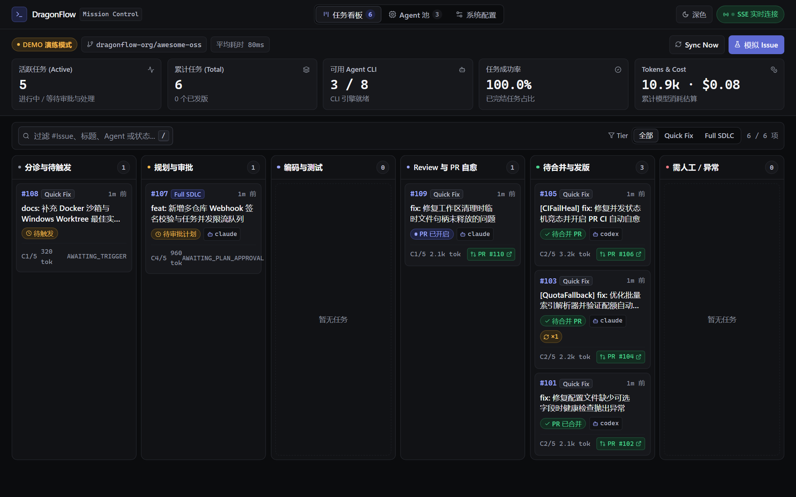
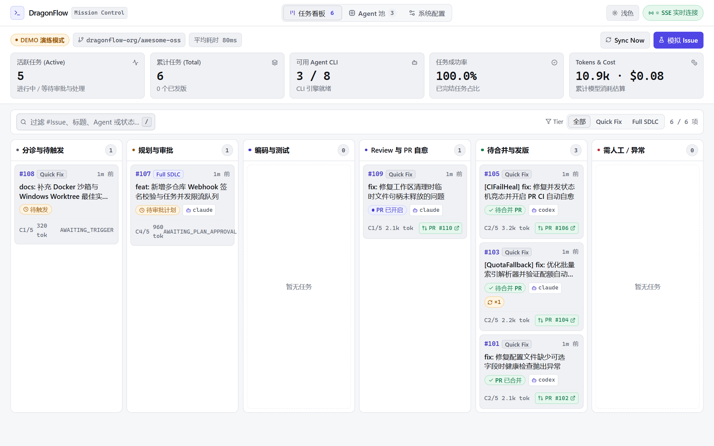
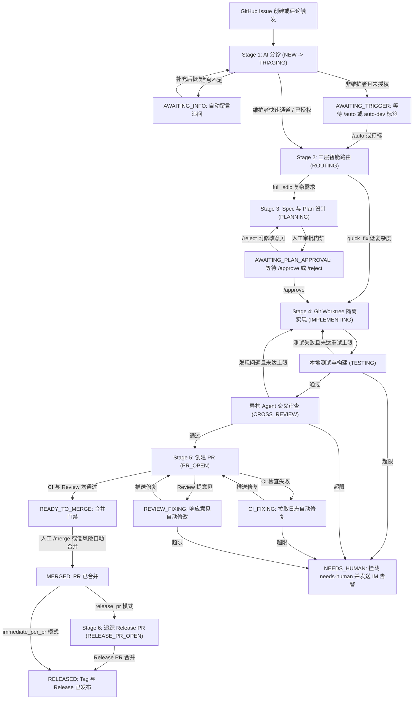
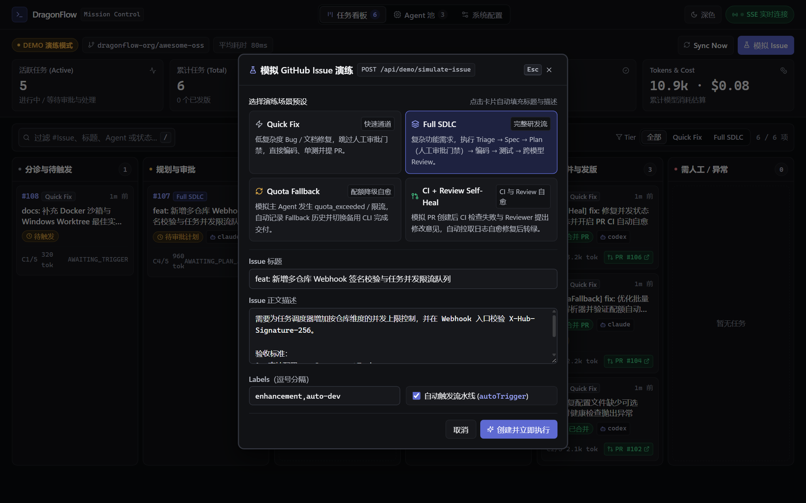
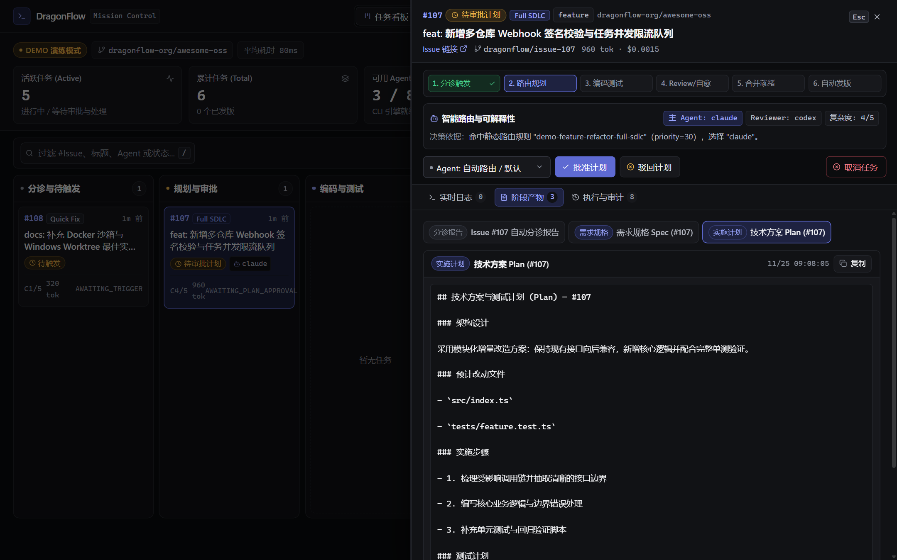
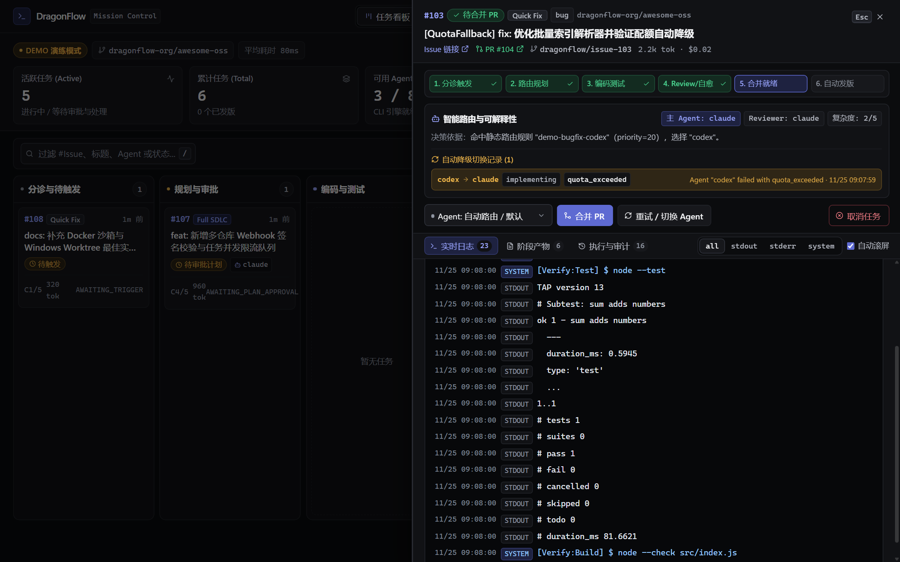
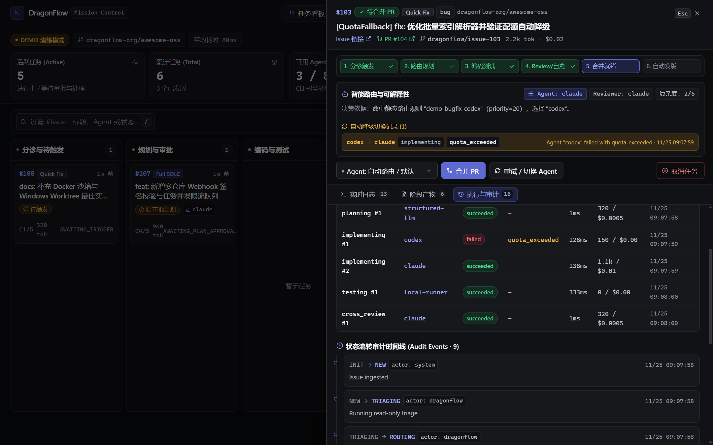
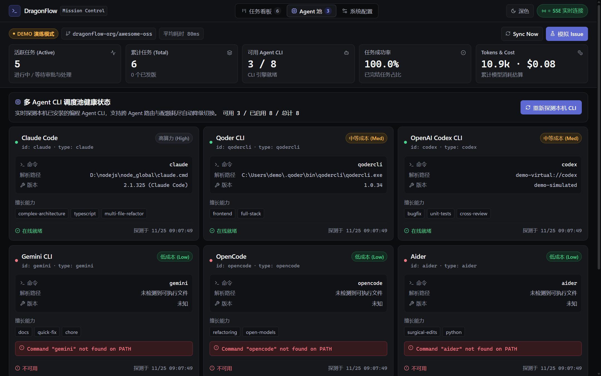
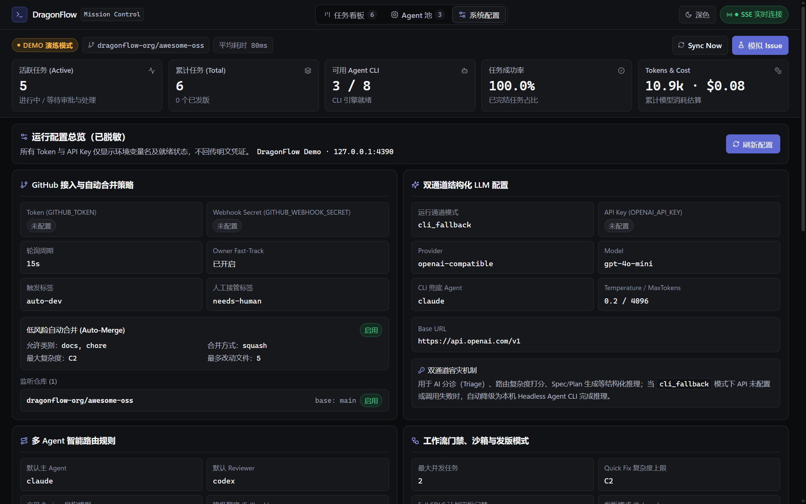

# DragonFlow（龙流）

> **把 GitHub 仓库的日常 Issue 处理、方案设计、编码测试、交叉审查、PR 修复与自动发版，变成一条“看得见、管得住、可审计”的 AI 研发流水线。**

[](https://nodejs.org/)
[](https://pnpm.io/)
[](./apps/desktop/README.md)
[](https://www.sqlite.org/)

DragonFlow 是一套面向 GitHub 开源项目与个人开发者的 **AI 全自动研发流水线与多 Agent 编排控制台**。你既可以通过 **Web 控制台** 跨平台运行，也可以直接使用 **Windows 原生桌面端**（系统托盘常驻 + Acrylic 快捷浮窗 + DPAPI 加密保险箱）。

即使你**还没有 GitHub Token，也没有任何 LLM API Key**，也能通过内置的 **零密钥 Demo 演练模式** 在 3 分钟内跑通完整闭环！



<details>
<summary>点击查看浅色主题效果（Light Mode）</summary>



</details>

---

## 目录

- [1. DragonFlow 能帮你做什么？（30 秒通俗看懂）](#1-dragonflow-能帮你做什么30-秒通俗看懂)
- [2. 两种运行形态怎么选？（Web 控制台 vs Windows 桌面端）](#2-两种运行形态怎么选web-控制台-vs-windows-桌面端)
- [3. 零基础 3 分钟快速体验（无需 GitHub Token / 无需 API Key）](#3-零基础-3-分钟快速体验无需-github-token--无需-api-key)
- [4. 控制台功能逐页面详解（附截图）](#4-控制台功能逐页面详解附截图)
  - [4.1 任务看板与 KPI 概览](#41-任务看板与-kpi-概览)
  - [4.2 模拟 Issue 演练弹窗](#42-模拟-issue-演练弹窗)
  - [4.3 任务详情抽屉：方案审批、实时日志、执行审计](#43-任务详情抽屉方案审批实时日志执行审计)
  - [4.4 多 Agent CLI 调度池](#44-多-agent-cli-调度池)
  - [4.5 系统配置总览](#45-系统配置总览)
- [5. 进阶实战：接入你自己的真实 GitHub 仓库（Live 模式保姆级教程）](#5-进阶实战接入你自己的真实-github-仓库live-模式保姆级教程)
  - [5.1 准备 GitHub Token](#51-准备-github-token)
  - [5.2 配置环境变量（.env）—— 支持无 API Key 纯本地 CLI 运行](#52-配置环境变量env-支持无-api-key-纯本地-cli-运行)
  - [5.3 修改配置文件（config/dragonflow.yaml）](#53-修改配置文件configdragonflowyaml)
  - [5.4 启动服务与 GitHub Webhook / 轮询](#54-启动服务与-github-webhook--轮询)
  - [5.5 配置飞书 / 钉钉 / 企业微信 / Slack 等通知机器人](#55-配置飞书--钉钉--企业微信--slack-等通知机器人)
  - [5.6 在 GitHub 评论区用斜杠指令遥控流水线](#56-在-github-评论区用斜杠指令遥控流水线)
- [6. Windows 原生桌面端使用与打包指南（apps/desktop）](#6-windows-原生桌面端使用与打包指南appsdesktop)
- [7. 核心原理：三层智能路由、8+1 CLI 适配与 6 阶段流水线](#7-核心原理三层智能路由81-cli-适配与-6-阶段流水线)
- [8. 给你的开源仓库接入 GitHub Actions CI & 自动发版模板](#8-给你的开源仓库接入-github-actions-ci--自动发版模板)
- [9. 项目目录结构与常用命令速查](#9-项目目录结构与常用命令速查)
- [10. 小白常见问题排查（FAQ）](#10-小白常见问题排查faq)

---

## 1. DragonFlow 能帮你做什么？（30 秒通俗看懂）

以前维护 GitHub 仓库时，每收到一个 Issue，你往往要手动看描述 -> 判断难易 -> 开分支改代码 -> 跑测试 -> 提 PR -> 等 CI 结果 -> 修报错 -> 合并 -> 打 Tag 发版。

**DragonFlow 把这一整套流程“流水线化”**，并且按任务复杂度自动分流，**关键节点保留人工把关，不瞎改、不乱合并**：

| 场景 | 以前手动处理 | 使用 DragonFlow 之后 |
| :--- | :--- | :--- |
| **社区新提 Issue** | 人工读半天，信息不够还要回复追问 | 自动 AI 分诊（类型/重复/复杂度 1~5 分），缺信息自动留言追问 |
| **陌生人提的 Issue** | 担心浪费额度或恶意指令 | 默认停在 **待触发（`AWAITING_TRIGGER`）**，等你打 `auto-dev` 标签或回复 `/auto` 才开干 |
| **简单小 Bug / 改文档** | 手动切分支改几行、跑测试、提 PR | 走 **`Quick Fix` 快速通道**：跳过方案审批，在独立 Git Worktree 自动编码、单测并提 PR |
| **复杂新功能 / 重构** | 怕 AI 直接瞎改大面积代码 | 走 **`Full SDLC` 完整研发流**：先写 Spec 规格和 Plan 方案，暂停等你点 **批准计划**（或评论 `/approve`）才动手写代码 |
| **某个 AI CLI 额度用光** | 任务直接卡死失败 | 自动识别 `quota_exceeded` / 限流，按配置顺序无缝切换到下一个备用 CLI（如 `codex` -> `claude`），并记录切换历史 |
| **PR 提上去 CI 红了** | 手动看 CI 日志再改代码再推送 | 自动拉取 CI 失败日志和 Review 意见，在分支上修复并重新推送，直到检查变绿 |
| **合并与发版** | 手动合并、手动写 Changelog、手动发 Release | 默认停在 **待合并（`READY_TO_MERGE`）** 等你确认 `/merge`，配合模板自动生成 Changelog 和 Release |

### 端到端全自动闭环流程图



---

## 2. 两种运行形态怎么选？（Web 控制台 vs Windows 桌面端）

DragonFlow 同一套代码仓库同时提供了 **Node.js + Web 控制台** 和 **Windows 原生桌面端**，核心引擎能力完全一致，新手可按自己的习惯任选其一：

| 对比维度 | Web 控制台（`apps/server` + `apps/web`） | Windows 原生桌面端（`apps/desktop`） |
| :--- | :--- | :--- |
| **适用平台** | Windows / macOS / Linux / 服务器部署 | Windows 10 / 11（基于 Wails v3 + Go） |
| **打开方式** | 命令行运行后用浏览器访问 `http://127.0.0.1:4390` | 双击 `DragonFlow.exe` 独立客户端窗口 |
| **后台驻留** | 终端进程常驻 | 关闭窗口自动最小化到 **系统托盘**，右键菜单 + **Acrylic 快捷浮窗** |
| **配置修改** | 编辑 YAML 配置文件 + `.env` | **内置 6 标签可视化配置编辑器**，改完直接点“保存并热重载”，还支持 YAML 导入导出 |
| **密钥安全** | 通过 `.env` 环境变量读取 | 内置 **Windows DPAPI 凭据保险箱**（`CryptProtectData` 加密存于 `secrets.vault`），不落明文 |
| **实时推送** | SSE（Server-Sent Events）实时推送 | Wails 原生事件通道 + Windows 系统通知弹窗 |
| **小白推荐度** | ⭐⭐⭐⭐⭐（3 条命令跑起来，跨平台通用） | ⭐⭐⭐⭐⭐（Windows 日常桌面使用最省心） |

---

## 3. 零基础 3 分钟快速体验（无需 GitHub Token / 无需 API Key）

> 💡 **提示**：Demo 模式会在本地自动创建一个模拟 Git 仓库并内置结构化 Mock 推理引擎，**绝对不会修改你的任何真实 GitHub 仓库，也不花一分钱 API 费用**。

### 第 1 步：确认电脑已安装以下 3 个基础工具

打开 PowerShell（Windows）或终端（macOS/Linux），分别运行下面 3 条命令检查版本：

```bash
node -v   # 需要 v22.0.0 或更高版本（内置 node:sqlite）
pnpm -v   # 需要 9.0.0 或更高版本
git -v    # 需要已安装 Git
```

- 如果没有 `node`，去 [Node.js 官网](https://nodejs.org/) 下载 **LTS (22+)** 安装。
- 如果有 Node 但没有 `pnpm`，运行一次：`npm install -g pnpm`（Windows 若提示执行策略限制，可参考 [第 10 节 FAQ](#10-小白常见问题排查faq)）。

### 第 2 步：下载源码并构建

```bash
git clone https://github.com/backbay2-yzg/dragonflow.git
cd dragonflow
pnpm install
pnpm build
```

> ⏱️ `pnpm install` 与 `pnpm build` 通常只需要几十秒。构建完成后，服务端与前端面板就已经打包就绪。

### 第 3 步：一键启动零密钥 Demo 控制台

```bash
pnpm demo
```

看到终端打印出如下提示，说明启动成功：

```text
[DragonFlow] Mode=demo | DB=... | Available CLIs: ...
[DragonFlow] Mission Control listening at http://127.0.0.1:4390 (mode=demo)
```

此时不要关闭这个终端窗口，直接打开浏览器访问：

👉 **http://127.0.0.1:4390**

### 第 4 步：跟着做一遍完整演练（5 步上手）

1. 打开页面后，你会看到顶部的 **浅色 / 深色 / 跟随系统** 主题按钮、右上角绿色 **SSE 实时连接** 状态胶囊，以及上方的 **模拟 Issue** 蓝色主按钮。
2. 点击右上角 **模拟 Issue** 按钮，弹出演练弹窗：
   - 先选 **Quick Fix** 卡片，保持勾选 `自动触发流水线 (autoTrigger)`，点击 **创建并立即执行**。
   - 你会看到任务自动经过分诊 -> 编码 -> 测试 -> Review -> 自动创建一个模拟 PR，然后停在 **待合并与发版** 列的 `待合并 PR` 状态！点击详情里的 **合并 PR** 即可模拟完成合并。
3. 再点一次 **模拟 Issue**，这次选 **Full SDLC** 卡片，点击 **创建并立即执行**：
   - 任务会在生成需求规格（Spec）与技术方案（Plan）后，停在 **规划与审批** 列的 `待审批计划` 状态。
   - 点开这张任务卡片，切换到 **阶段产物** 查看方案，然后点击顶部 **批准计划**，它就会继续完成编码、测试、交叉 Review 并创建 PR。
4. 想体验 **“主 Agent 配额耗尽自动切备用”**？点 **模拟 Issue** -> 选 **Quota Fallback**（注意标题里保留 `[QuotaFallback]` 标记），创建后查看详情里的 **自动降级切换记录** 和 **执行与审计** 标签页！
5. 想体验 **“PR 提交后 CI 失败自动自愈”**？点 **模拟 Issue** -> 选 **CI + Review Self-Heal**（标题保留 `[CIFailHeal]` 标记），创建后在看板点击右上角 **Sync Now** 触发检查，观察它自动从 `CI 自愈修复中` 恢复为 `待合并 PR`！

---

## 4. 控制台功能逐页面详解（附截图）

### 4.1 任务看板与 KPI 概览

主界面顶部与看板区让所有任务的全局进度一目了然：


- **顶部导航栏（52px）**：
  - 中间 3 个主视图切换：**任务看板**（显示总任务数）、**Agent 池**（显示当前在线可用的 CLI 数量）、**系统配置**。
  - 右侧支持一键切换 **浅色 / 深色 / 跟随系统** 主题，以及查看 **SSE 实时连接** 心跳状态。
- **KPI 指标条**：
  - 实时展示 **活跃任务 (Active)**、**累计任务 (Total)**（含已发版数量）、**可用 Agent CLI**、**任务成功率**、**Tokens & Cost** 累计估算。
  - 右侧两个快捷操作：**Sync Now**（立即同步 GitHub Issue 与 PR 状态）、**模拟 Issue**（Demo 模式下用于快速创建测试任务）。
- **过滤工具栏与快捷键**：
  - 键盘按 `/` 键可瞬间聚焦搜索框，支持按 `#Issue` 编号、标题关键词、Agent 名称、状态或标签过滤。
  - 右侧可按 **全部 / Quick Fix / Full SDLC** 分级筛选。
- **6 列状态看板**：
  1. **分诊与待触发**：`NEW`、`TRIAGING`、`AWAITING_INFO`、`AWAITING_TRIGGER`
  2. **规划与审批**：`ROUTING`、`PLANNING`、`AWAITING_PLAN_APPROVAL`
  3. **编码与测试**：`IMPLEMENTING`、`TESTING`
  4. **Review 与 PR 自愈**：`CROSS_REVIEW`、`PR_OPEN`、`CI_FIXING`、`REVIEW_FIXING`
  5. **待合并与发版**：`READY_TO_MERGE`、`MERGED`、`RELEASE_PR_OPEN`、`RELEASED`
  6. **需人工 / 异常**：`NEEDS_HUMAN`、`FAILED`、`CANCELLED`
- **卡片上的小徽标怎么看**：
  - `C2/5`：AI 评估的任务复杂度（1 最简单，5 最复杂）。
  - `×1` 黄色胶囊：说明执行期间触发了 1 次 **Agent 配额/故障自动降级切换**。
  - 绿色 `PR #104` 链接：可直接点击跳转到对应的 Pull Request。

### 4.2 模拟 Issue 演练弹窗

在 Demo 模式下点击 **模拟 Issue**，内置 4 种开箱即用的典型研发场景预设，点击卡片即可自动填充标题、正文与标签，也支持你自由修改：



- **Quick Fix（快速通道）**：低复杂度 Bug 或文档修正，跳过人工 Plan 审批直接实现。
- **Full SDLC（完整研发流）**：中/高复杂度功能，严格生成 Spec 与 Plan 并暂停等待人工审批。
- **Quota Fallback（配额降级自愈）**：模拟主 Agent 触发 `quota_exceeded`，自动按降级链切换备用 Agent 继续交付。
- **CI + Review Self-Heal（CI 与 Review 自愈）**：模拟 PR 开启后 CI 失败，自动拉取日志修复后转绿。
- **关闭 `自动触发流水线 (autoTrigger)` 勾选**：可模拟外部社区贡献者提交的 Issue，观察它如何安全停留在 **待触发** 列等待维护者放行。

### 4.3 任务详情抽屉：方案审批、实时日志、执行审计

点击看板上的任意一张任务卡片，右侧会滑出 **任务详情抽屉**（按 `Esc` 可快速关闭）：

#### ① 方案审批门禁与阶段产物（`Full SDLC`）



- **顶部 6 阶段进度条**：直观标出当前卡在 `1. 分诊触发` -> `2. 路由规划` -> `3. 编码测试` -> `4. Review/自愈` -> `5. 合并就绪` -> `6. 自动发版` 哪一环。
- **智能路由与可解释性卡片**：清晰告诉你为什么选了这个主 Agent 和 Reviewer（例如命中了哪条静态路由规则、优先级多少、复杂度几分）。
- **人工操作工具栏**：
  - 在 `待触发` 状态：可下拉指定特定 Agent 或使用自动路由，点击 **触发执行**。
  - 在 `待审批计划` 状态：点击 **批准计划** 直接放行编码；或点击 **驳回计划** 并填写修改建议让 AI 重新规划。
  - 在 `待合并 PR` 状态：点击 **合并 PR** 完成合并。
  - 遇到异常或想重试：支持指定备用 Agent 点击 **重试 / 切换 Agent**，也可随时点击 **取消任务**。
- **阶段产物标签页**：集中保留 AI 分诊报告（`triage`）、需求规格（`spec`）、实施计划（`plan`）、本地测试报告（`test_report`）、交叉 Review 意见（`review`）、代码 Diff（`diff`）与 PR 描述（`pr_body`），支持一键复制 Markdown 内容。

#### ② 实时日志控制台与自动降级记录



- 当任务发生额度耗尽或限流时，智能路由卡片下方会自动展开 **自动降级切换记录**（例如 `codex -> claude | implementing | quota_exceeded`）。
- **实时日志** 面板采用高对比度深色终端区（无论浅色还是深色主题下都保持终端清晰可读），支持按 `all` / `stdout` / `stderr` / `system` 过滤输出，并支持 **自动滚屏** 查看执行与测试命令输出。

#### ③ 执行记录与状态机审计时间线



- **执行与审计** 标签页完整记录每一次子阶段调用（`triage` / `routing` / `planning` / `implementing` / `testing` / `cross_review` 等）：用了哪个 Agent、成功还是失败、错误分类（如 `quota_exceeded`）、耗时、Tokens 与估算费用，以及每一次任务状态转换的完整审计时间线。

### 4.4 多 Agent CLI 调度池

点击顶部导航 **Agent 池**，可以查看本机所有配置好的编码 CLI 健康状况：



- 启动时自动探测系统 `PATH` 中已安装的编程 CLI（在 Windows 上自动兼容 `.exe`、`.cmd` 与 `.ps1`），并采集可执行文件路径与版本号。
- 每张卡片展示：**在线就绪 / 不可用 / 已禁用** 状态、成本等级（`Low` / `Med` / `High`）、启动命令、解析路径、版本号与擅长能力标签（`strengths`）。
- 如果你刚新装了某个 CLI，无需重启服务，直接点击右上角 **重新探测本机 CLI** 即可刷新状态并加入调度池。

### 4.5 系统配置总览

点击顶部导航 **系统配置**，可以核对当前加载生效的所有配置项：



- **严格脱敏原则**：Web 控制台只展示环境变量名（如 `GITHUB_TOKEN`、`OPENAI_API_KEY`）以及“已配置 / 未配置”状态，**永远不会向浏览器回传任何明文密钥**。
- 可一目了然检查 GitHub 接入仓库、Owner Fast-Track、低风险自动合并策略、双通道 LLM 模式、智能路由规则与降级顺序、并发与重试上限、沙箱与发版模式、IM 通知渠道，以及内置可一键复制的 GitHub Actions CI 工作流片段。

---

## 5. 进阶实战：接入你自己的真实 GitHub 仓库（Live 模式保姆级教程）

体验完 Demo 后，只需 4 步就能把 DragonFlow 接到你自己的真实 GitHub 仓库上。

### 5.1 准备 GitHub Token

1. 登录 GitHub，进入 **Settings -> Developer settings -> Personal access tokens**（推荐 Fine-grained tokens 或 Classic PAT）。
2. 选择你要托管的仓库，勾选以下最低必要权限：
   - **Issues**: Read and write（读写 Issue 标签与评论）
   - **Pull requests**: Read and write（创建 PR、回复评审意见、合并 PR）
   - **Contents**: Read and write（拉取代码与推送开发分支）
   - **Checks**: Read-only（读取 CI 检查状态）
   - **Actions**: Read-only（读取失败 Workflow 日志用于自愈）
3. 生成后复制保存这串 Token（以 `ghp_` 或 `github_pat_` 开头）。

### 5.2 配置环境变量（.env）—— 支持无 API Key 纯本地 CLI 运行

在项目根目录复制一份环境变量模板：

```bash
# macOS / Linux / Git Bash
cp .env.example .env

# Windows PowerShell
Copy-Item .env.example .env
```

用编辑器打开 `.env`，按你的实际情况填写：

- **必填项**：
  ```dotenv
  GITHUB_TOKEN=你的GitHub_Token
  DRAGONFLOW_CONFIG=config/dragonflow.yaml
  ```
- **结构化 AI 决策通道（二选一）**：
  - **情况 A（你有 OpenAI / DeepSeek / Anthropic / Gemini 等 API Key）**：
    填入对应的 Key（支持任意 OpenAI 兼容接口，如 DeepSeek、SiliconFlow、OpenRouter、Ollama 等）：
    ```dotenv
    OPENAI_API_KEY=sk-xxxx
    OPENAI_BASE_URL=https://api.openai.com/v1
    ```
  - **情况 B（你没有单独买 API Key，只想用本机已经登录好的编码 CLI，比如 Claude Code / Codex / Gemini CLI / QoderCLI）**：
    `.env` 里的 LLM Key 可以全部留空！只要在下一步的 `config/dragonflow.yaml` 中把 `llm.mode` 改为 `"cli_only"`（或保持默认的 `"cli_fallback"`），DragonFlow 就会自动调用本机已登录的无头 CLI 完成分诊和规划推理！

### 5.3 修改配置文件（config/dragonflow.yaml）

复制生产配置模板：

```bash
# macOS / Linux / Git Bash
cp config/dragonflow.example.yaml config/dragonflow.yaml

# Windows PowerShell
Copy-Item config/dragonflow.example.yaml config/dragonflow.yaml
```

打开 `config/dragonflow.yaml`，**小白上手只需重点改下面 4 处**：

1. **填你的 GitHub 仓库（`github.repositories`）**：
   ```yaml
   github:
     repositories:
       - owner: "你的GitHub用户名或组织名"
         repo: "你的仓库名"
         baseBranch: "main"
         enabled: true
         testCommand: "pnpm test"          # 改成你仓库的测试命令，如 pytest -q / go test ./...
         buildCommand: "pnpm build"        # 改成你的构建命令，没有可删掉
         lintCommand: "pnpm run --if-present lint"
   ```
2. **填有权发斜杠指令的维护者账号（`github.maintainers`）**：
   ```yaml
     maintainers:
       - "你的GitHub用户名"
   ```
3. **确认 AI 分诊通道模式（`llm`）**：
   - 有 API Key 填 `mode: "cli_fallback"`（API 优先，失败自动退回 CLI）。
   - 没有 API Key 直接写 `mode: "cli_only"`，并把 `cliFallbackAgentId` 改成你本机可用的一款 CLI（如 `"claude"`、`"codex"`、`"qodercli"`）。
4. **确认工作流安全门禁（`workflow`）**：
   默认 `requirePlanApprovalForFullSdlc: true` 且 `github.autoMergeLowRisk.enabled: false`，也就是**复杂需求必经你审批，且合并 PR 默认等你确认**，建议新手保持默认值！

### 5.4 启动服务与 GitHub Webhook / 轮询

确保前后端已构建后，运行：

```bash
pnpm build
pnpm start
```

（若需要前端热更新调试，可分两个终端运行 `pnpm dev:server` 与 `pnpm dev:web`。）

- **无公网 IP 也能直接用（默认已开启轮询）**：DragonFlow 默认每 `30` 秒轮询一次 GitHub（可在 `github.pollIntervalSec` 调整），因此即使跑在家里/公司内网的个人电脑上，也能正常监听新 Issue、新评论和 CI 状态！
- **有公网地址可配 Webhook 实现秒级响应**：
  1. 在 `.env` 设置 `GITHUB_WEBHOOK_SECRET=一段随机密钥`。
  2. 在 GitHub 目标仓库进入 `Settings -> Webhooks -> Add webhook`：
     - **Payload URL**：`https://你的域名/webhooks/github`
     - **Content type**：`application/json`
     - **Secret**：与 `.env` 中的 `GITHUB_WEBHOOK_SECRET` 一致
     - **Events**：勾选 `Issues`、`Issue comments`、`Pull requests`、`Pull request reviews`、`Check suites`、`Check runs`、`Releases`

### 5.5 配置飞书 / 钉钉 / 企业微信 / Slack 等通知机器人

想让 DragonFlow 在 **等待你审批方案**、**PR 可以合并**、**需要人工介入** 或 **正式发版** 时在群里提醒你？

1. 在 `.env` 中填入对应群机器人的 Webhook URL（飞书 / 钉钉还可选填签名密钥）：
   ```dotenv
   FEISHU_WEBHOOK_URL=https://open.feishu.cn/open-apis/bot/v2/hook/xxxx
   FEISHU_WEBHOOK_SECRET=xxxx
   ```
   支持渠道变量包括：`FEISHU_WEBHOOK_URL`、`DINGTALK_WEBHOOK_URL`、`WECOM_WEBHOOK_URL`、`SLACK_WEBHOOK_URL`、`DISCORD_WEBHOOK_URL`、`TELEGRAM_BOT_TOKEN` + `TELEGRAM_CHAT_ID`。
2. 在 `config/dragonflow.yaml` 的 `notifications.channels` 下将对应渠道改为 `enabled: true` 即可。

### 5.6 在 GitHub 评论区用斜杠指令遥控流水线

当你在外面不方便打开控制台时，**直接在 GitHub 对应 Issue 或 PR 的评论区回复以下斜杠指令**，DragonFlow 监听到后会立刻执行（仅限维护者与 `github.maintainers` 列表成员触发）：

| 指令 | 适用状态 | 作用说明 |
| :--- | :--- | :--- |
| `/auto` | `AWAITING_TRIGGER` / 新建 Issue | 批准外部贡献者的 Issue 启动自动化研发流程 |
| `/approve` | `AWAITING_PLAN_APPROVAL` | 审批通过 Spec 与 Plan，放行 AI 开始写代码 |
| `/reject <修改意见>` | `AWAITING_PLAN_APPROVAL` | 打回方案并附带建议（如 `/reject 请拆分中间件并补充边界测试`），触发重新规划 |
| `/fix <修复指引>` | `PR_OPEN` / `CI_FIXING` / `REVIEW_FIXING` / `NEEDS_HUMAN` | 人工补充修复提示，驱动 Agent 在当前分支再次修改并推送 |
| `/retry` | `NEEDS_HUMAN` / `FAILED` | 人工解决外部阻塞（如补全 Secret 或解完冲突）后从断点恢复任务 |
| `/merge` | `READY_TO_MERGE` | 人工确认合并门禁，触发 PR 合并进入 `MERGED` |
| `/cancel` | 任意非终态任务 | 立即中止当前任务并流转至 `CANCELLED` |

---

## 6. Windows 原生桌面端使用与打包指南（apps/desktop）

如果你习惯使用独立的 Windows 客户端，DragonFlow 提供了基于 **Go + Wails v3 + React 19** 打造的原生桌面应用（位于 `apps/desktop`），除包含 Web 控制台全部核心功能外，还提供以下桌面专属特性：

- **无需开命令行 & 系统托盘常驻**：关闭主窗口会自动隐藏至 Windows 系统托盘，不中断后台轮询与执行。托盘图标会按状态自动切换（空闲 / 运行中 / 需人工确认）。
- **Acrylic 快捷浮窗（Tray Flyout）**：左键单击系统托盘图标弹出半透明快捷面板，一眼查看进行中任务、待审批/待合并卡点并支持一键 **批准方案 / 合并 PR / 触发执行**。
- **Win11 Mica/Tabbed 无边框窗口**：支持浅色 / 深色 / 跟随系统三态自动同步窗口标题栏外观。
- **6 标签可视化配置编辑器**：无需手写 YAML，直接在桌面端图形化编辑 **常规与桌面**、**GitHub 仓库**、**LLM 与路由**、**Agent CLI 池**、**IM 通知**，改完一键 **保存并热重载**。
- **Windows DPAPI 凭据保险箱**：GitHub Token、LLM Key 和 IM Webhook 地址均通过 Windows 原生 `CryptProtectData` 加密存储在 `secrets.vault` 中，不写明文到 `dragonflow.yaml`。
- **支持开机静默启动与便携模式**：
  - 常规安装数据目录：`%APPDATA%\DragonFlow`（分别维护 `dragonflow.db` 与 `demo\dragonflow-demo.db`）。
  - 便携绿色版模式：在 `DragonFlow.exe` 同级目录新建一个空文件 `portable.flag`（或加 `--portable` 参数启动），所有数据库、配置和 Worktree 将自动保存在程序同级 `data\` 目录中。
  - 支持 `--minimized` 启动直接静默驻留托盘。

### 从源码运行或打包 Windows 桌面端

前提要求：已安装 **Go >= 1.26**、**Node.js >= 22 + pnpm >= 9** 以及 **Wails v3 CLI**（`go install github.com/wailsapp/wails/v3/cmd/wails3@latest`）。

```bash
cd apps/desktop

# 1. 开发模式（热重载）
wails3 dev

# 2. 构建便携可执行文件（输出到 apps/desktop/bin/DragonFlow.exe）
wails3 build

# 3. 打包 Windows NSIS 安装向导（需本机已安装 NSIS）
wails3 task package
```

更多桌面端开发说明可查看 [apps/desktop/README.md](apps/desktop/README.md)。

---

## 7. 核心原理：三层智能路由、8+1 CLI 适配与 6 阶段流水线

### 7.1 三层编码 Agent 智能路由

每当一个任务进入 `ROUTING` 阶段，调度器会按以下 3 层顺序决定由谁写代码、由谁做 Cross-Review：

1. **Layer 1：显式静态规则（`routing.rules`）**
   按 `priority` 从小到大匹配：分诊类别（`categories`）、Issue 标签（`labels`）、标题正则（`titleRegex`）、复杂度区间（`complexityMin` ~ `complexityMax`）。命中后直接指定主 `agentId`、专属 `fallbackAgents` 以及是否强制指定 `tierOverride`（`quick_fix` 或 `full_sdlc`）。
2. **Layer 2：LLM 智能评估**
   未命中静态规则时，将任务描述、复杂度与当前本机在线 Agent 的 `strengths`（擅长领域）和 `costTier` 交给 LLM，选出最适合的 Agent（记录 `selectedBy: "llm"` 及完整决策理由）。
3. **Layer 3：默认兜底与故障自动降级（`fallbackOrder`）**
   - 无法完成智能评估时回退至 `routing.defaultAgent`。
   - 运行中只要遇到 **额度耗尽（`quota_exceeded`）**、**限流（`rate_limited`）**、**鉴权失败（`auth_failed`）**、**超时（`timeout`）** 或 **运行时错误（`runtime_error`）**，立即按规则的 `fallbackAgents` 或全局 `routing.fallbackOrder` 切换下一个可用 CLI，并将切换原因记入 `fallbackHistory` 及推送 `agent_fallback` 通知。
   - 开启 `routing.crossReviewDifferentAgent: true` 后，Cross-Review 阶段会自动挑选与主实现 Agent 不同的异构 Agent 做交叉审查。

### 7.2 内置 8 种编程 CLI + 第 9 种 YAML 自定义模板

DragonFlow 内置 8 种主流编码 CLI 适配器，所有 CLI 均支持统一配置 `promptMode`（`stdin` / `arg` / `file`）、`outputMode`（`text` / `json` / `stream-json`）、`timeoutSec`、`maxBudgetUsd` 与 `envAllowlist`：

| `type` | 工具名称 | 擅长领域示例 | 默认提示词传递方式 |
| :--- | :--- | :--- | :--- |
| `claude` | Claude Code | 复杂架构、多文件重构、TypeScript、深度 Review | `stdin` |
| `codex` | OpenAI Codex CLI | Bug 修复、单元测试、后端工程、算法 | `stdin` |
| `gemini` | Google Gemini CLI | 文档完善、大上下文分析、前端与代码评审 | `stdin` |
| `qodercli` | Qoder CLI | 全栈功能、前端页面、中文上下文开发 | `stdin` |
| `opencode` | OpenCode | 多模型适配、开源模型接入、低成本修复 | `stdin` / `arg` |
| `aider` | Aider | 精准局部修改、Python、重构 | `file` |
| `workbuddy` | WorkBuddy CLI | 企业级工作流、全栈功能 | `stdin` |
| `codebuddy` | CodeBuddy CLI | 代码生成、测试用例补全、代码 Review | `stdin` |
| `template` | **YAML 自定义模板** | 接入任意第三方或企业自研编码 CLI（无需改源码） | `stdin` / `arg` / `file` |

**零代码接入第 9 种自定义 CLI 示例**：只需在 `config/dragonflow.yaml` 的 `agents` 列表中增加一条 `type: "template"` 配置（支持 `{{model}}`、`{{cwd}}`、`{{promptFile}}`、`{{prompt}}`、`{{branch}}` 占位符）：

```yaml
- id: "my-custom-cli"
  displayName: "My Custom Coding CLI"
  type: "template"
  enabled: true
  command: "my-agent-cli"
  model: "deepseek-coder"
  promptMode: "file"
  outputMode: "text"
  template:
    argsTemplate:
      - "exec"
      - "--model"
      - "{{model}}"
      - "--cwd"
      - "{{cwd}}"
      - "--prompt-file"
      - "{{promptFile}}"
    quotaErrorPatterns:
      - "quota exceeded"
      - "rate limit reached"
    versionArgs:
      - "--version"
```

### 7.3 标准 6 阶段研发流与 20 个状态机状态

| 阶段 | 包含状态（`TaskStatus`） | 核心职责与人工把关点 |
| :--- | :--- | :--- |
| **1. Issue 分诊** | `NEW` -> `TRIAGING` -> `AWAITING_INFO` -> `AWAITING_TRIGGER` | 识别类别、重复率与 1~5 复杂度；信息不全时追问；非维护者任务停在待触发门禁 |
| **2. 路由与规划** | `ROUTING` -> `PLANNING` -> `AWAITING_PLAN_APPROVAL` | 三层路由分配主/审 Agent；`full_sdlc` 生成 Spec/Plan 并暂停等待 `/approve` 或 `/reject` |
| **3. 隔离实现与测试** | `IMPLEMENTING` -> `TESTING` | 在独立 Git Worktree（或预留 Docker 沙箱）中写代码并跑 `lint`/`test`/`build`，失败按 `maxLocalFixRetries` 自愈 |
| **4. 交叉审查与 PR** | `CROSS_REVIEW` -> `PR_OPEN` -> `CI_FIXING` -> `REVIEW_FIXING` | 异构 Agent 审查后自动创建 PR；持续监听远程 CI 与 Review 评论并拉取日志自动修复 |
| **5. 合并门禁** | `READY_TO_MERGE` -> `MERGED` | 低风险可配 `autoMergeLowRisk` 自动合并，其余一律等待人工 `/merge` 或点击合并按钮 |
| **6. 发版与终态** | `RELEASE_PR_OPEN` -> `RELEASED` / `NEEDS_HUMAN` / `FAILED` / `CANCELLED` | 追踪 Release Please PR 或合并即发版；重试超限时挂 `needs-human` 标签并发出 IM 告警 |

---

## 8. 给你的开源仓库接入 GitHub Actions CI & 自动发版模板

[templates/github-workflows/](templates/github-workflows) 目录已经为你准备好了开箱即用的 GitHub Actions 模板，直接复制到**目标仓库**即可：

1. **接入 PR 与主干 CI 检查**：
   将 [templates/github-workflows/ci.yml](templates/github-workflows/ci.yml) 复制到 `目标仓库/.github/workflows/ci.yml`。
   - 默认为 **Node.js 22 + pnpm 9**（自动运行 `lint`、`typecheck`、`test`、`build`）。
   - 若你的仓库是 **Python / Go / Rust**，文件内部已经附带注释好的完整模板，取消对应语言段的注释即可。
2. **接入自动发版（二选一，需与 `dragonflow.yaml` 中 `release.mode` 保持一致）**：
   - **方案 A：Release PR 模式（推荐，对应 `release.mode: "release_pr"`）**
     复制以下 3 个文件到目标仓库：
     - [release-please.yml](templates/github-workflows/release-please.yml) -> `.github/workflows/release-please.yml`
     - [release-please-config.json](templates/github-workflows/release-please-config.json) -> `release-please-config.json`
     - [.release-please-manifest.json](templates/github-workflows/.release-please-manifest.json) -> `.release-please-manifest.json`
     每次常规 PR 合并后自动维护 `chore(main): release` Release PR，合并后自动生成 `CHANGELOG.md`、Git Tag 与 GitHub Release。
   - **方案 B：合并即发版模式（对应 `release.mode: "immediate_per_pr"`）**
     仅复制 [immediate-release.yml](templates/github-workflows/immediate-release.yml) -> `.github/workflows/immediate-release.yml`，每次 PR 合并到 `main` 后根据 Conventional Commits 自动计算 SemVer 版本号并发布 Release。

---

## 9. 项目目录结构与常用命令速查

### 目录结构

```text
dragonflow/
├── apps/
│   ├── server/                 # @dragonflow/server：Hono HTTP API、SSE 事件流、Demo/Live 启动入口
│   ├── web/                    # @dragonflow/web：React 19 + Vite + Tailwind CSS v4 Web 控制台
│   └── desktop/                # Go + Wails v3 + React 19 Windows 原生桌面端（含系统托盘与 DPAPI 保险箱）
├── packages/
│   ├── core/                   # @dragonflow/core：编排引擎、SQLite WAL 数据库、EventBus、GitHub/Worktree/Agent 适配
│   └── shared/                 # @dragonflow/shared：跨端共享协议、20 状态机、Zod 配置 Schema
├── config/
│   ├── dragonflow.demo.yaml    # 零密钥离线 Demo 模式预置配置
│   └── dragonflow.example.yaml # 生产环境完整注释配置模板
├── templates/
│   └── github-workflows/       # 开箱即用的 GitHub Actions CI & Release 模板
├── docs/
│   └── screenshots/            # README 控制台功能截图
├── .env.example                # 环境变量配置模板
├── DESIGN.md                   # UI/UX 与双主题设计系统规范
└── package.json                # 根工作区脚本
```

### 常用命令速查

| 命令 | 说明 |
| :--- | :--- |
| `pnpm install` | 安装全部工作区依赖 |
| `pnpm build` | 构建 `shared`、`core`、`web` 与 `server` |
| `pnpm demo` | 一键启动零密钥 Demo 演练服务端（默认监听 `127.0.0.1:4390`） |
| `pnpm start` | 启动生产服务端（读取 `DRAGONFLOW_CONFIG` 环境变量或默认配置） |
| `pnpm dev:server` | 以热监听模式启动后端服务 |
| `pnpm dev:web` | 启动前端 Vite 开发服务器（联调界面用） |
| `pnpm typecheck` | 对全仓 TypeScript 项目执行类型检查 |
| `pnpm test` | 运行全仓 Vitest 单元测试与端到端集成测试 |
| `cd apps/desktop && go test ./...` | 运行 Windows 桌面端 Go 后端单元测试 |
| `cd apps/desktop && wails3 build` | 编译生成 Windows 桌面版 `DragonFlow.exe` |

---

## 10. 小白常见问题排查（FAQ）

<details>
<summary><b>Q1：Windows PowerShell 运行 pnpm 时提示“在此系统上禁止运行脚本”怎么办？</b></summary>

这是 Windows PowerShell 的默认脚本执行策略限制。用普通权限打开 PowerShell 执行一次以下命令即可放行当前用户：

```powershell
Set-ExecutionPolicy -ExecutionPolicy RemoteSigned -Scope CurrentUser
```

</details>

<details>
<summary><b>Q2：我没有 OpenAI / Anthropic / Gemini API Key，能不能跑真实 GitHub 仓库？</b></summary>

可以！只要你本机已经装好并登录过任意一款编码 CLI（如 `claude`、`codex`、`gemini`、`qodercli`、`opencode`），在 `config/dragonflow.yaml` 中将 `llm.mode` 设为 `"cli_only"`，并把 `llm.cliFallbackAgentId` 设为你已登录的那个 CLI ID，就只需要填写 `GITHUB_TOKEN`，不需要任何额外 API Key。

</details>

<details>
<summary><b>Q3：Agent 池里显示某个 CLI “不可用 / command not found”，但我明明装过？</b></summary>

1. 先在终端单独运行一次 `where claude`（Windows）或 `which claude`（macOS/Linux）确认它在系统 `PATH` 中。
2. 如果你通过 `npm install -g` 安装后刚改过环境变量，请重启终端或桌面应用，再在 **Agent 池** 页面点击 **重新探测本机 CLI**。
3. Windows 上 `.ps1` / `.cmd` / `.exe` 均会被自动识别，调度器会以安全的参数隔离方式执行（推荐保持 `promptMode: "stdin"` 或 `"file"`，避免命令行超长或特殊字符转义出错）。

</details>

<details>
<summary><b>Q4：为什么我在目标仓库新提了一个 Issue，它停在“待触发”不动？</b></summary>

检查两件事：
1. 你当前提交 Issue 的 GitHub 账号是否是仓库的 `OWNER` / `MEMBER` / `COLLABORATOR`，或者是否被加入到了 `config/dragonflow.yaml` 的 `github.maintainers` 列表中。
2. 出于防滥用安全门禁，非维护者提交的 Issue 默认会停留在 `AWAITING_TRIGGER`；你只需要在 GitHub 给该 Issue 贴上 `auto-dev` 标签、在评论区回复 `/auto`，或在控制台详情抽屉点击 **触发执行** 即可立即启动。

</details>

<details>
<summary><b>Q5：Windows 上运行 Git Worktree 有什么需要注意的？</b></summary>

1. **开启 Git 长路径支持**：防止深层 `node_modules` 超过 Windows 260 字符路径限制，建议运行一次：
   ```bash
   git config --global core.longpaths true
   ```
2. **路径尽量简短**：在生产配置中尽量把 `workspace.reposRoot` 和 `workspace.worktreeRoot` 放在较浅的目录（如 `D:\df-data\repos`）。
3. **防止文件句柄占用**：如果编辑器正打开着某个任务的临时 Worktree 目录，清理时可能被占用，建议任务结束后再清理或按需开启 `workspace.cleanupOnFinish: true`。
4. **强隔离环境（Docker 沙箱预留）**：如果目标仓库强依赖 Linux 编译工具链，可将 `workspace.runner` 配置为 `"docker"`（配合 Windows WSL2 + Docker Desktop，默认镜像 `node:22-bookworm`）。

</details>

<details>
<summary><b>Q6：启动提示 `4390` 端口被占用怎么办？</b></summary>

可以在配置文件 `server.port` 修改默认端口，或在启动命令后追加 `--port` 参数临时指定端口，例如：

```bash
node apps/server/dist/index.js --demo --config config/dragonflow.demo.yaml --port 4395
```

</details>
